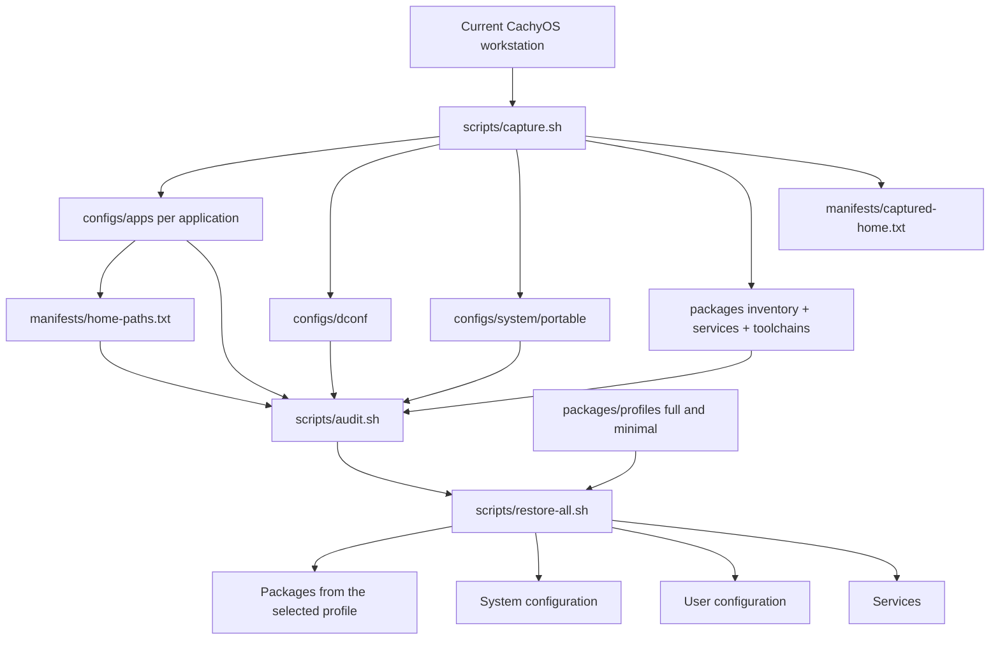

# cachyos-config

[](https://cachyos.org/)


[](README.zh-CN.md)

**English** · [简体中文](README.zh-CN.md)

Personal CachyOS workstation configuration, kept as a versioned snapshot with
scripts to capture and restore it. Managed files, package and service manifests
are stored separately, so each layer can be inspected or restored on its own.

For a fresh system, install the base from the
[CachyOS download page](https://cachyos.org/download/) (torrent recommended),
then use this repository to restore the workstation configuration.

## Architecture



## Publishing and restoring

Git is the transport: capture on the machine you configure, restore on any other machine.

Managed files are copied, not symlinked: `configs/apps/<app>/` is the only copy of
each declared `$HOME` path, and restore reads it back directly.
The active shell is native Noctalia (observed `v5.2.1 (5.2.1-1-dirty)`),
with `config.toml`/`widgets.toml` plus saved GUI overrides in
`.local/state/noctalia/settings.toml` and the local `storage_gb` plugin.
After a GUI change is saved, capture it before publishing; restore deploys the
saved snapshot without backfilling retired JSON settings. The managed paths are
listed in the [configuration map](docs/en/configuration.md).

**Publish from the current machine** after any config, package, or service change:

```bash
./scripts/capture.sh      # rebuild the snapshot from the current machine
./scripts/audit.sh        # refuse to publish if secrets or private paths leaked

git add -A
git commit -m "sync: refresh snapshot"
git push
```

`./scripts/sync-configs.sh --check` verifies the live `$HOME` still matches the
snapshot without changing anything.

Passwordless push setup: `gh auth login` plus an SSH key added to GitHub; see
`docs/en/security.md` for what must never enter the repository.

**Apply on another machine** (fresh CachyOS install or any other computer):

```bash
git clone https://github.com/Eurekaimer/cachyos-config.git
cd cachyos-config

./scripts/audit.sh                   # review what the snapshot contains
./scripts/restore-all.sh --dry-run   # preview every replacement and install
./scripts/restore-all.sh             # packages, system, user config, services
sudo reboot
```

The default flow never touches machine-bound state: no disk UUIDs,
`/etc/machine-id`, `/etc/fstab`, or `/etc/hostname` are read or written. A
different username on the target machine is fine — absolute home paths in
managed files are rewritten for the current user at restore time.

The final post-restore step disables supported UPower battery charge thresholds
to allow charging to 100%; this hardware preference is not a Noctalia TOML setting.
The native power panel displays the charging-time estimate when available from
the battery/UPower; zero charging power cannot provide a reliable estimate.
User-config restore retains existing KOReader `data/dict` contents, even with
`--no-backup`, and does not rewrite dictionary definitions as configuration.

## Documentation

+ [Configuration map and restore boundaries](docs/en/configuration.md) · [中文](docs/zh-CN/configuration.md)
+ [Capture and snapshot maintenance](docs/en/capture.md) · [中文](docs/zh-CN/capture.md)
+ [Recovery workflow](docs/en/recovery.md) · [中文](docs/zh-CN/recovery.md)
+ [Packages and services](docs/en/packages-services.md) · [中文](docs/zh-CN/packages-services.md)
+ [Security and publishing boundaries](docs/en/security.md) · [中文](docs/zh-CN/security.md)

Component notes live next to what they describe: `modules/<module>/README.md`
for installers, and `configs/apps/<app>/` for application configuration.
