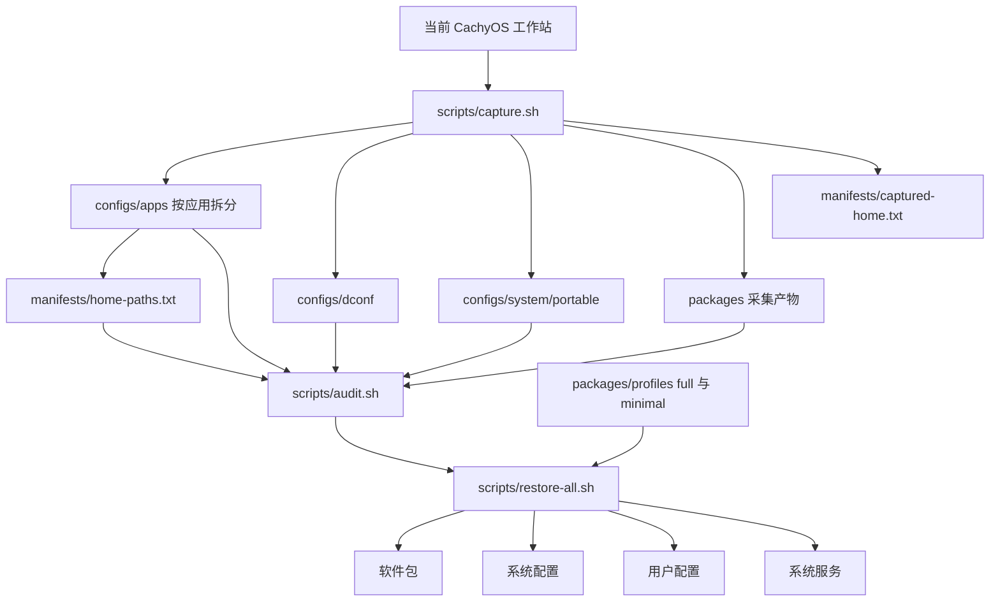

# cachyos-config

[](https://cachyos.org/)


[](README.md)

[English](README.md) · **简体中文**

个人 CachyOS 工作站的配置快照与恢复脚本。托管文件、软件与服务清单彼此分离，
每一层都可以独立检查或单独恢复。

全新系统请先按 [CachyOS 官方下载页](https://cachyos.org/download/) 安装基础
系统（建议使用种子下载），再用本仓库恢复工作站配置。

## 架构



## 发布与恢复

Git 就是传输介质：在配置好的机器上采集，在任意其他机器上恢复。

纳管文件使用复制，**不是软链接**：`configs/apps/<应用>/` 是每条声明路径的唯一
副本，恢复直接从它读回。当前桌面外壳为原生 Noctalia，实测版本
`v5.2.1 (5.2.1-1-dirty)`；底层配置为 `config.toml`/`widgets.toml`，
GUI 覆盖保存在 `.local/state/noctalia/settings.toml`，并保留本地 `storage_gb` 插件。
GUI 改动保存后应先采集再发布；恢复只部署已保存快照，不回填淘汰的 JSON 配置。
托管路径清单见[配置地图](docs/zh-CN/configuration.md)。

**在当前机器上发布**（配置、软件包或服务有任何改动后）：

```bash
./scripts/capture.sh     # 从当前机器重建快照
./scripts/audit.sh       # 有密钥或隐私路径泄漏则拒绝发布

git add -A
git commit -m "sync: refresh snapshot"
git push
```

`./scripts/sync-configs.sh --check` 用于确认实时 `$HOME` 仍与快照一致，且不修改任何文件。

免密推送：`gh auth login` 并把 SSH 公钥加到 GitHub；不该入库的内容见
`docs/zh-CN/security.md`。

**在另一台机器上应用**（全新 CachyOS 安装或其他电脑）：

```bash
git clone https://github.com/Eurekaimer/cachyos-config.git
cd cachyos-config

./scripts/audit.sh                   # 先检查快照内容
./scripts/restore-all.sh --dry-run   # 预览所有替换与安装操作
./scripts/restore-all.sh             # 软件包、系统、用户配置、服务
sudo reboot
```

默认流程不涉及任何机器专属状态：不会读写磁盘 UUID、`/etc/machine-id`、
`/etc/fstab` 或 `/etc/hostname`。目标机器用户名不同也没关系——托管文件中的绝对
home 路径会在恢复时自动改写为当前用户。

恢复收尾会关闭 UPower 支持的电池充电阈值，允许充至 100%；此偏好是硬件状态，
不属于 Noctalia TOML。原生电源面板沿用电池/UPower 的充满时间估算，
充电功率为零时无法提供可靠倒计时。
用户配置恢复会保留 KOReader 已有的 `data/dict`，即使使用 `--no-backup`
也不删除词典，且词典释义不会参与配置文件的 home 路径改写。

## 文档

+ [配置位置与恢复边界](docs/zh-CN/configuration.md) · [English](docs/en/configuration.md)
+ [采集与快照维护](docs/zh-CN/capture.md) · [English](docs/en/capture.md)
+ [恢复流程](docs/zh-CN/recovery.md) · [English](docs/en/recovery.md)
+ [软件包与服务](docs/zh-CN/packages-services.md) · [English](docs/en/packages-services.md)
+ [安全与公开边界](docs/zh-CN/security.md) · [English](docs/en/security.md)

组件说明与组件本身放在一起：模块看 `modules/<module>/README.md`，应用配置看
`configs/apps/<应用>/` 下的 README。
