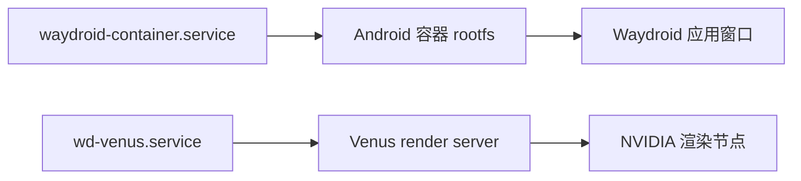

# Waydroid（Android 容器，NVIDIA/Venus 变体）

[English](../en/waydroid.md)

本文保留此前 NVIDIA/Venus Android 容器方案的使用说明。截至 2026-10-19 采集，
本机已不再安装 Waydroid；恢复流程不会自动安装 `waydroid-nvidia-bin`，
也不会启用 `waydroid-container.service`。现存 `wd-venus.service` 和 UFW 配置保留。

此前方案由 `waydroid-nvidia-bin` 提供 Venus/Virtio-GPU 访客驱动和补丁版
surfaceflinger，`wd-venus.service` 运行 virgl render server，udev 规则给
`/dev/udmabuf` 加 `uaccess`。下文命令仅适用于自行安装了可用 Waydroid/NVIDIA
软件包的机器。



## 与快照的关系

| 内容 | 位置 | 恢复行为 |
| --- | --- | --- |
| 软件包 | `waydroid-nvidia-bin` | 已从采集清单和 `full` 安装 profile 移除，不自动安装 |
| 系统服务 | `waydroid-container.service` | 已不在采集的启用服务清单中，不自动启用 |
| 用户服务 | `wd-venus.service` | 仍在 `packages/services/user.txt` 中；unit 存在时由 `restore-services.sh` 恢复启用 |
| UFW 规则 | `waydroid0` 的 DHCP/DNS 与转发规则 | 随 `configs/system/portable/etc/ufw/` 恢复 |
| 容器数据 | `/var/lib/waydroid/`（rootfs、镜像、`waydroid.cfg`、`waydroid.prop`、`nv/`，约 2.5 GB） | 不在白名单，属机器本地数据；恢复后需要重新初始化 |

内核无需额外配置：CachyOS 内核内建 `CONFIG_ANDROID_BINDER_IPC` 与
`CONFIG_ANDROID_BINDERFS`，`/etc/modules-load.d/` 里没有相关条目。

## 日常操作

| 操作 | 命令 |
| --- | --- |
| 查看状态 | `waydroid status` |
| 启动会话 | `waydroid session start` |
| 显示完整界面 | `waydroid show-full-ui` |
| 启动单个应用 | `waydroid app launch <package>` |
| 停止会话 | `waydroid session stop` |

此前方案中，`waydroid status` 的 `Vendor type` 为 `MAINLINE`，表示镜像来源；
桌面启动器条目名为 `Waydroid`。

## 恢复后重新初始化

在目标机器自行安装可用的 Waydroid/NVIDIA 软件包后，按顺序初始化机器本地容器数据：

```bash
sudo waydroid init                      # 下载并初始化 Android 镜像（数 GB，网络受限时需代理）
sudo waydroid-nvidia-setup --refresh 144  # 按显示器刷新率配置 NVIDIA/Venus 栈
```

`waydroid-nvidia-setup` 必须在 `waydroid init` 之后运行，脚本可重复执行；调整显示器
刷新率或内核更新后重跑即可。刷新率高于 240 Hz 时会启用包内补丁版 surfaceflinger 的
vsync-snap 路径，普通刷新率不需要。
